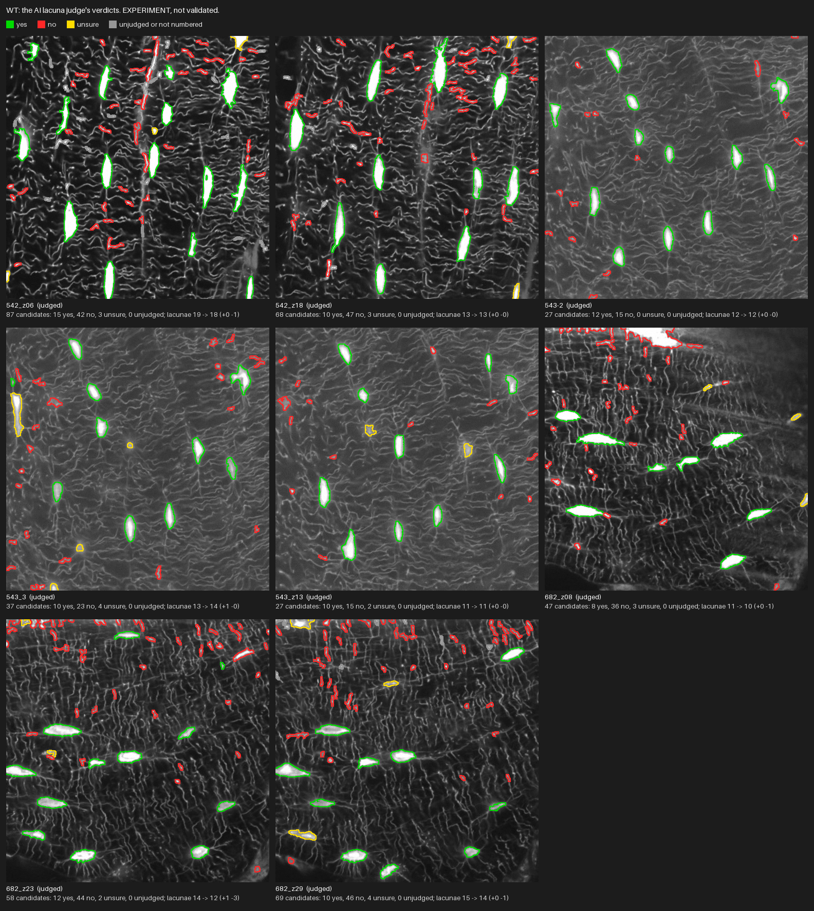
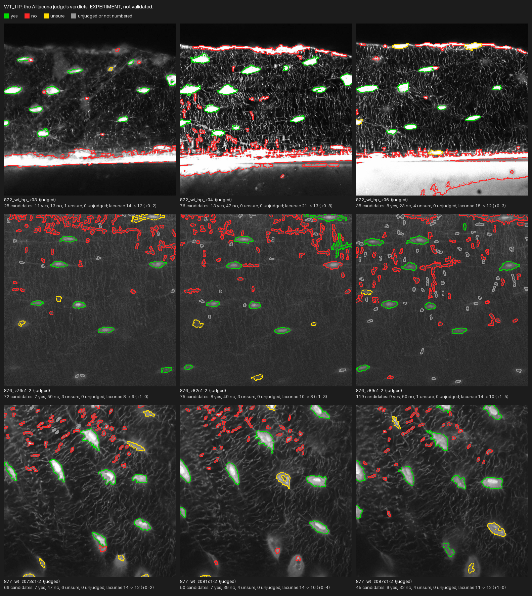
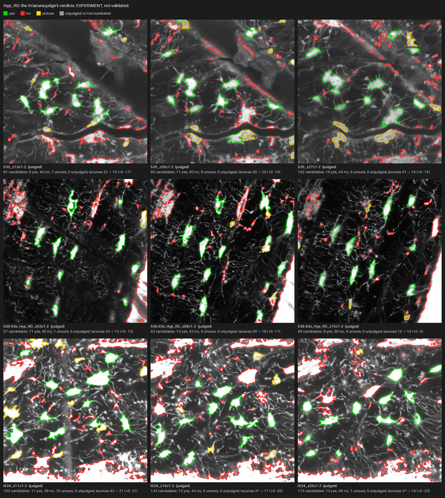
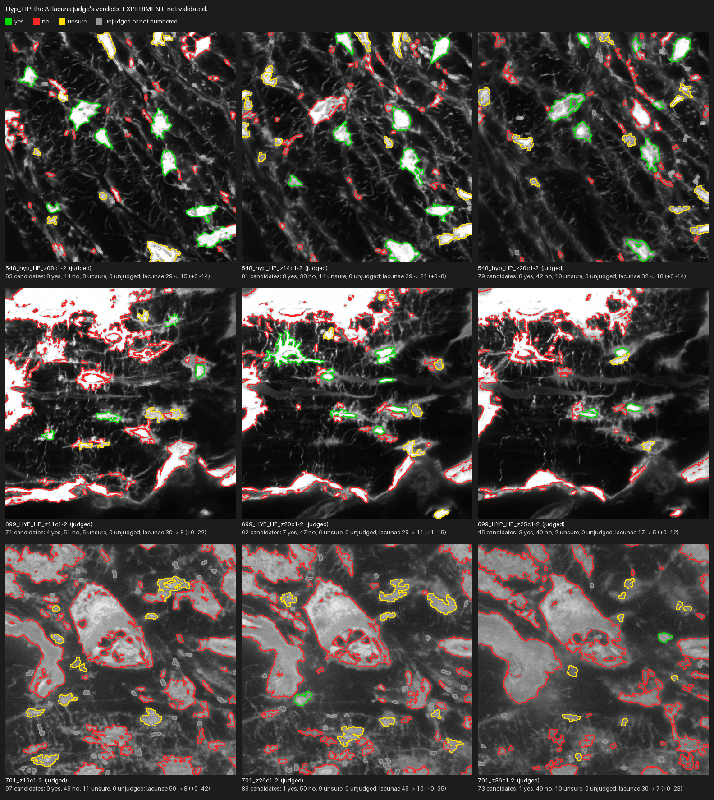

# AI lacuna judge: review

**EXPERIMENT, pre-validation. NOT VALIDATED: no verdict here has been checked against a manual count.** What the AI lacuna judge said about every candidate region, made by `python src/diagnostics.py ai-lacuna-review` from the decision files in `results_ai_lacunae/<group>/ai_log/` and the candidates rebuilt from the cached lacuna stage. No call was made to make it.

On every thumbnail each candidate region is outlined in the colour of its verdict: **green yes, red no, yellow unsure, grey unjudged** (a region the judge did not answer, or one the cap left without a number, which keeps the deterministic decision). The thumbnail is the raw signal channel at every second pixel. A region added is a yes on a region the filters rejected or on a dim candidate; a region removed is a no on a region the filters kept; unsure and unjudged keep the deterministic decision. The boundaries are the lacuna stage's own: the judge draws none.

Per image only: nothing here compares groups, and no statistic is computed. Every region's verdict and the judge's one line why are in `review_regions.csv`.

The run: 35 of 35 images, model `claude-sonnet-5-5`, $0.825286 spent.

## WT

| image | image_code | status | candidates | numbered | not numbered (over the cap) | yes | no | unsure | unjudged | regions added | of those, dim candidates | regions removed | lacunae before | lacunae after | attempts | cost USD |
| --- | --- | --- | --- | --- | --- | --- | --- | --- | --- | --- | --- | --- | --- | --- | --- | --- |
| 542_z06 | img_9335ebdc | judged | 87 | 60 | 27 | 15 | 42 | 3 | 0 | 0 | 0 | 1 | 19 | 18 | 1 | 0.024506 |
| 542_z18 | img_ef5ccdb6 | judged | 68 | 60 | 8 | 10 | 47 | 3 | 0 | 0 | 0 | 0 | 13 | 13 | 1 | 0.02479 |
| 543-2 | img_ad1a1a86 | judged | 27 | 27 | 0 | 12 | 15 | 0 | 0 | 0 | 0 | 0 | 12 | 12 | 1 | 0.016938 |
| 543_3 | img_1a4e2621 | judged | 37 | 37 | 0 | 10 | 23 | 4 | 0 | 1 | 1 | 0 | 13 | 14 | 1 | 0.019396 |
| 543_z13 | img_8aba8947 | judged | 27 | 27 | 0 | 10 | 15 | 2 | 0 | 0 | 0 | 0 | 11 | 11 | 1 | 0.017404 |
| 682_z08 | img_7174a32e | judged | 47 | 47 | 0 | 8 | 36 | 3 | 0 | 0 | 0 | 1 | 11 | 10 | 1 | 0.022044 |
| 682_z23 | img_0b12aba2 | judged | 58 | 58 | 0 | 12 | 44 | 2 | 0 | 1 | 1 | 3 | 14 | 12 | 1 | 0.023876 |
| 682_z29 | img_b6ed8081 | judged | 69 | 60 | 9 | 10 | 46 | 4 | 0 | 0 | 0 | 1 | 15 | 14 | 1 | 0.024576 |

## WT_HP

| image | image_code | status | candidates | numbered | not numbered (over the cap) | yes | no | unsure | unjudged | regions added | of those, dim candidates | regions removed | lacunae before | lacunae after | attempts | cost USD |
| --- | --- | --- | --- | --- | --- | --- | --- | --- | --- | --- | --- | --- | --- | --- | --- | --- |
| 872_wt_hp_z03 | img_d0dcd70a | judged | 25 | 25 | 0 | 11 | 13 | 1 | 0 | 0 | 0 | 2 | 14 | 12 | 1 | 0.017128 |
| 872_wt_hp_z04 | img_1927df57 | judged | 76 | 60 | 16 | 13 | 47 | 0 | 0 | 0 | 0 | 8 | 21 | 13 | 1 | 0.025132 |
| 872_wt_hp_z06 | img_96e5a40f | judged | 35 | 35 | 0 | 8 | 23 | 4 | 0 | 0 | 0 | 3 | 15 | 12 | 1 | 0.019086 |
| 876_z76c1-2 | img_b1a8effc | judged | 72 | 60 | 12 | 7 | 50 | 3 | 0 | 1 | 1 | 0 | 8 | 9 | 1 | 0.024866 |
| 876_z82c1-2 | img_2183dbdf | judged | 75 | 60 | 15 | 8 | 49 | 3 | 0 | 1 | 1 | 3 | 10 | 8 | 1 | 0.024156 |
| 876_z89c1-2 | img_73c55f34 | judged | 119 | 60 | 59 | 9 | 50 | 1 | 0 | 1 | 1 | 5 | 14 | 10 | 1 | 0.026314 |
| 877_wt_z073c1-2 | img_ca3e4b7d | judged | 66 | 60 | 6 | 7 | 47 | 6 | 0 | 0 | 0 | 2 | 14 | 12 | 1 | 0.02462 |
| 877_wt_z081c1-2 | img_d5472ff8 | judged | 50 | 50 | 0 | 7 | 39 | 4 | 0 | 0 | 0 | 4 | 14 | 10 | 1 | 0.022246 |
| 877_wt_z087c1-2 | img_8ed25fa4 | judged | 45 | 45 | 0 | 9 | 32 | 4 | 0 | 1 | 1 | 0 | 11 | 12 | 1 | 0.022308 |

## Hyp_RD

| image | image_code | status | candidates | numbered | not numbered (over the cap) | yes | no | unsure | unjudged | regions added | of those, dim candidates | regions removed | lacunae before | lacunae after | attempts | cost USD |
| --- | --- | --- | --- | --- | --- | --- | --- | --- | --- | --- | --- | --- | --- | --- | --- | --- |
| 535_z13c1-2 | img_7f6141d8 | judged | 81 | 60 | 21 | 8 | 45 | 7 | 0 | 0 | 0 | 17 | 32 | 15 | 1 | 0.024656 |
| 535_z20c1-2 | img_040277b8 | judged | 85 | 60 | 25 | 11 | 40 | 9 | 0 | 0 | 0 | 10 | 30 | 20 | 1 | 0.025522 |
| 535_z27c1-2 | img_5b6863f6 | judged | 102 | 60 | 42 | 10 | 44 | 6 | 0 | 0 | 0 | 15 | 31 | 16 | 1 | 0.025126 |
| 536-63x_Hyp_RD_z03c1-2 | img_3e061e35 | judged | 57 | 57 | 0 | 11 | 45 | 1 | 0 | 0 | 0 | 12 | 24 | 12 | 1 | 0.024684 |
| 536-63x_Hyp_RD_z08c1-2 | img_03ae62fe | judged | 63 | 60 | 3 | 13 | 42 | 5 | 0 | 0 | 0 | 11 | 29 | 18 | 1 | 0.024486 |
| 536-63x_Hyp_RD_z15c1-2 | img_e88aa2e9 | judged | 49 | 49 | 0 | 9 | 36 | 4 | 0 | 0 | 0 | 5 | 15 | 10 | 1 | 0.022468 |
| I534_z11c1-2 | img_981d8b06 | judged | 163 | 60 | 103 | 11 | 39 | 10 | 0 | 0 | 0 | 21 | 42 | 21 | 1 | 0.024864 |
| I534_z19c1-2 | img_c9307eb7 | judged | 133 | 60 | 73 | 12 | 43 | 5 | 0 | 0 | 0 | 20 | 37 | 17 | 1 | 0.025206 |
| I534_z25c1-2 | img_898a7c63 | judged | 115 | 60 | 55 | 13 | 46 | 1 | 0 | 0 | 0 | 23 | 37 | 14 | 1 | 0.025714 |

## Hyp_HP

| image | image_code | status | candidates | numbered | not numbered (over the cap) | yes | no | unsure | unjudged | regions added | of those, dim candidates | regions removed | lacunae before | lacunae after | attempts | cost USD |
| --- | --- | --- | --- | --- | --- | --- | --- | --- | --- | --- | --- | --- | --- | --- | --- | --- |
| 548_hyp_HP_z08c1-2 | img_7e105582 | judged | 83 | 60 | 23 | 8 | 44 | 8 | 0 | 0 | 0 | 14 | 29 | 15 | 1 | 0.025202 |
| 548_hyp_HP_z14c1-2 | img_4ba7fa39 | judged | 81 | 60 | 21 | 8 | 38 | 14 | 0 | 0 | 0 | 8 | 29 | 21 | 1 | 0.025198 |
| 548_hyp_HP_z20c1-2 | img_27daf452 | judged | 79 | 60 | 19 | 8 | 42 | 10 | 0 | 0 | 0 | 14 | 32 | 18 | 1 | 0.024642 |
| 699_HYP_HP_z11c1-2 | img_f3a94933 | judged | 71 | 60 | 11 | 4 | 51 | 5 | 0 | 0 | 0 | 22 | 30 | 8 | 1 | 0.025904 |
| 699_HYP_HP_z20c1-2 | img_13106fa0 | judged | 62 | 60 | 2 | 7 | 47 | 6 | 0 | 1 | 0 | 15 | 25 | 11 | 1 | 0.025094 |
| 699_HYP_HP_z25c1-2 | img_bb63db29 | judged | 45 | 45 | 0 | 3 | 40 | 2 | 0 | 0 | 0 | 12 | 17 | 5 | 1 | 0.022664 |
| 701_z19c1-2 | img_c8338be9 | judged | 97 | 60 | 37 | 0 | 49 | 11 | 0 | 0 | 0 | 42 | 50 | 8 | 1 | 0.025094 |
| 701_z26c1-2 | img_a4c37628 | judged | 89 | 60 | 29 | 1 | 50 | 9 | 0 | 0 | 0 | 35 | 45 | 10 | 1 | 0.024834 |
| 701_z36c1-2 | img_284346ef | judged | 73 | 60 | 13 | 1 | 49 | 10 | 0 | 0 | 0 | 23 | 30 | 7 | 1 | 0.024542 |
